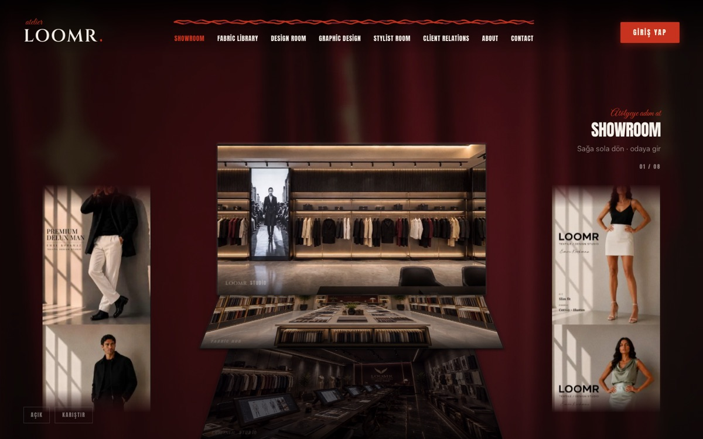
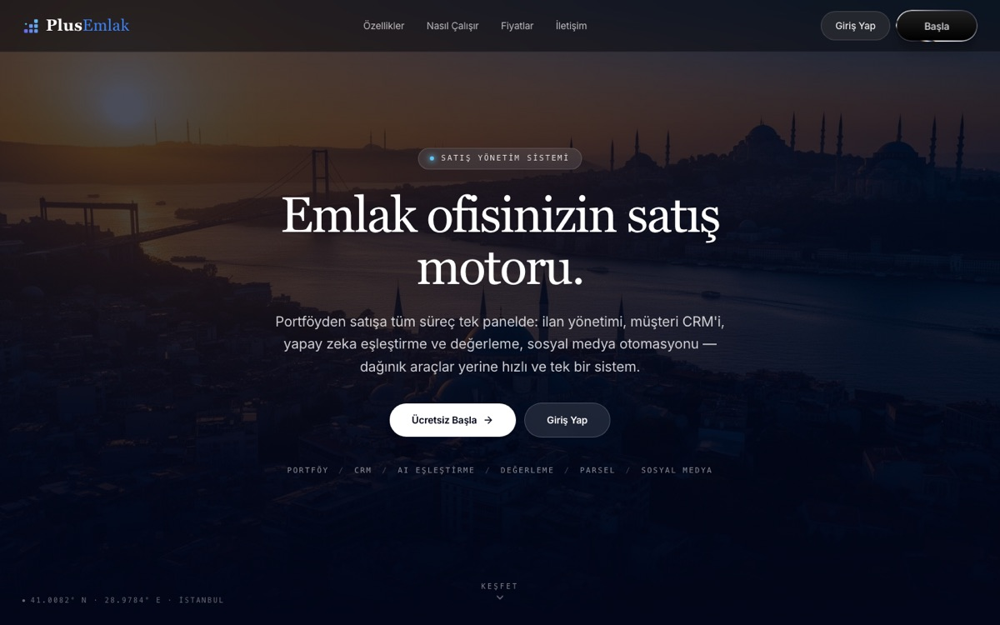

#### What I work on

#### Open source: Git Hospital

[Git Hospital](https://github.com/Git-Hospital) · [Helmbulance](https://github.com/Git-Hospital/helmbulance)

#### Shipped

<table>
<tr>
<td width="50%" valign="top">

 <b><a href="https://www.loomr.net">LOOMR</a></b> — the platform site for a fashion design
studio: an interactive atelier with showroom, fabric library, design and stylist rooms.
</td>
<td width="50%" valign="top">

 <b><a href="https://3.74.95.123.sslip.io">PlusEmlak</a></b> — CRM and automation for real
estate offices: listings, client CRM, AI matching and valuation, social media automation.
</td>
</tr>
</table>

#### Open source contributions

[SeaweedFS](https://github.com/seaweedfs/seaweedfs) [#11720](https://github.com/seaweedfs/seaweedfs/pull/11720) [#12137](https://github.com/seaweedfs/seaweedfs/pull/12137) [#12138](https://github.com/seaweedfs/seaweedfs/pull/12138) [#12139](https://github.com/seaweedfs/seaweedfs/pull/12139) ·
[JupyterHub](https://github.com/jupyterhub/zero-to-jupyterhub-k8s) [#3997](https://github.com/jupyterhub/zero-to-jupyterhub-k8s/pull/3997) ·
[Reloader](https://github.com/stakater/Reloader) [#1270](https://github.com/stakater/Reloader/pull/1270) [#1271](https://github.com/stakater/Reloader/pull/1271) [#1281](https://github.com/stakater/Reloader/pull/1281) ·
[OpenArchiver](https://github.com/LogicLabs-OU/OpenArchiver) [#493](https://github.com/LogicLabs-OU/OpenArchiver/pull/493) ·
[Achilles](https://github.com/crabnebula-dev/achilles) [#29](https://github.com/crabnebula-dev/achilles/pull/29) [#28](https://github.com/crabnebula-dev/achilles/pull/28) ·
[Hanko](https://github.com/teamhanko/hanko) [#2996](https://github.com/teamhanko/hanko/pull/2996)
